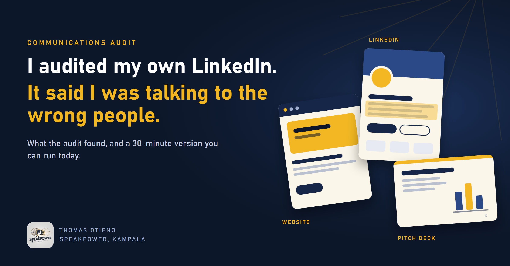
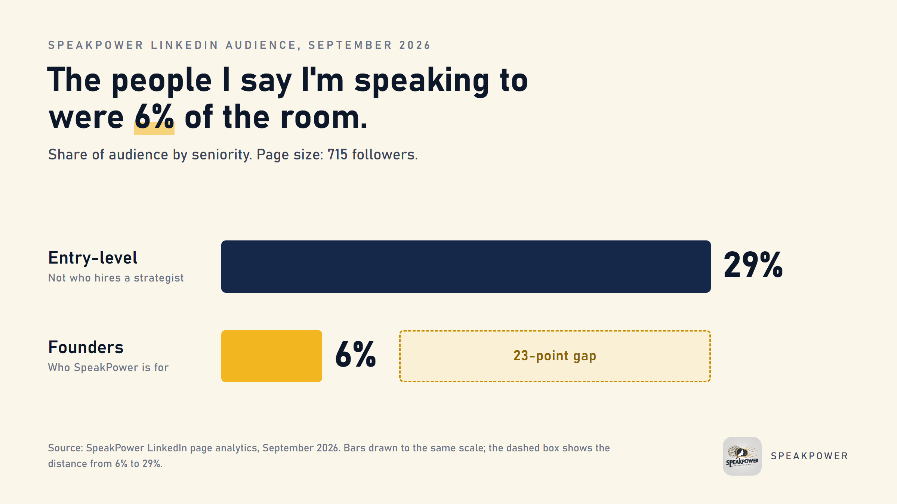
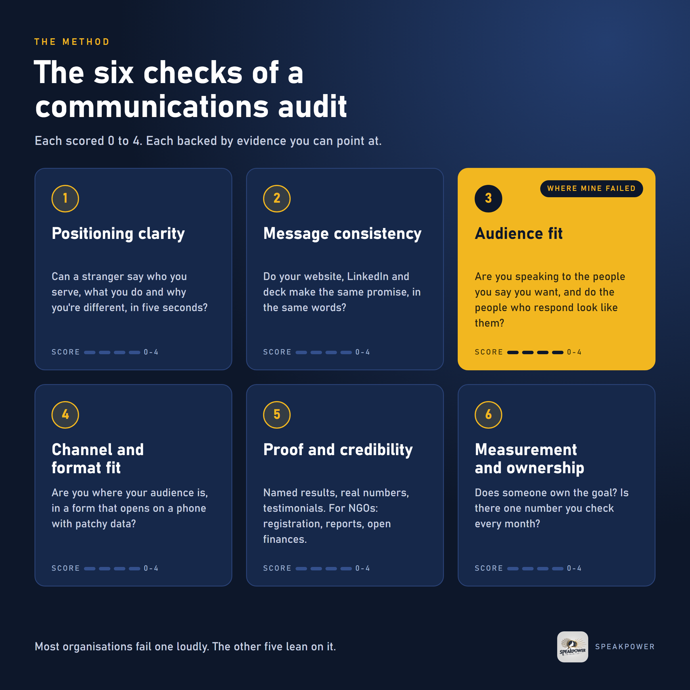
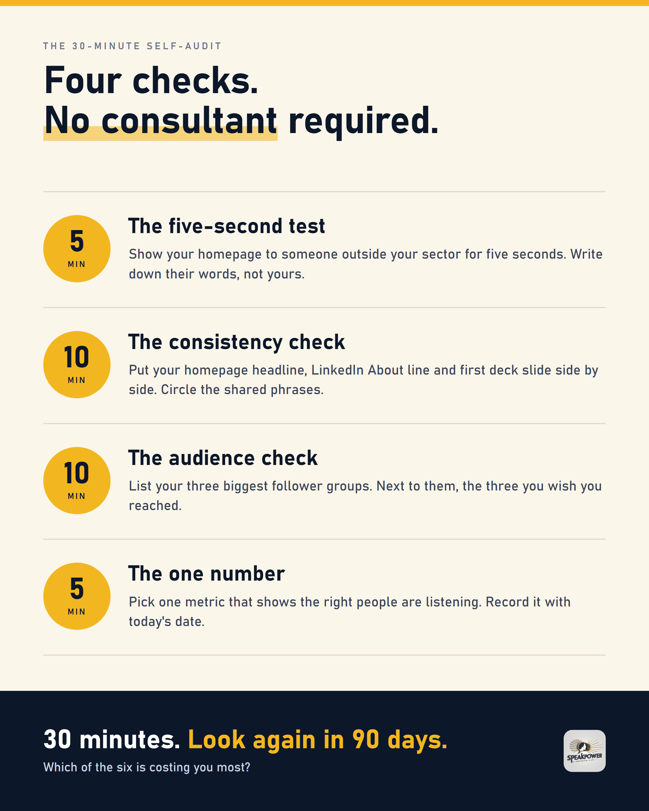

<!--
PUBLISH BLOCK (blog). Remove this comment before pasting the body.
SEO title:        Communications Audit: What I Found Auditing My Own LinkedIn
Meta description: A communications audit shows who actually hears your message. See the six checks I use, what mine found, and a 30-minute version you can run today.
URL slug:         communications-audit-founders-ngos
Target keyword:   communications audit
Secondary:        audit your messaging, NGO communications, founder brand, positioning clarity
Service line:     2. Communication Audits (bridges 1. Strategy & Market Development)
Pillar:           Strategy & Market Development
Written for:      TARGET audience (founders, NGO leaders, corporate decision-makers)
-->

# I Audited My Own LinkedIn. It Said I Was Talking to the Wrong People.

*Alt text: Overhead view of a printed website homepage, a LinkedIn profile and a pitch deck laid side by side on a desk, slightly out of line.*

I sell communications audits.

So in September, I pointed one at myself.

(Yes, the audit consultant needed an audit. I'll wait while you enjoy that.)

I've told clients for years that you can't fix what you haven't measured. Turns out that applies to the person doing the telling.

SpeakPower's LinkedIn page had 715 followers. I was posting on a seven-days-a-week calendar. The posts were decent.

Then I opened the audience analytics.

Entry-level professionals made up 29% of my audience. Founders made up 6%.

Six.

And founders are exactly who I say I'm speaking to.

*Alt text: Two horizontal bars. Entry-level professionals, 29% of the SpeakPower LinkedIn audience. Founders, 6%.*

## The message was fine. The match was wrong.

Here's what stung.

Nothing I'd posted was bad. Read one by one, you'd probably nod along.

But an audit doesn't read posts one by one. It asks a different question: is the right person hearing the right thing, in the right place?

I was sharing public speaking tips. Useful ones, for people building their confidence. A lovely audience, honestly.

Just not the one that hires a strategist.

So I was speaking clearly to people who couldn't buy, and only faintly to people who could.

That's the trap of being busy. A full content calendar feels like a strategy.

It isn't. It's a calendar.

And the dashboard won't warn you. Followers go up. Impressions go up. Nobody sends a notification that says, "These are not your buyers." You have to go looking.

## But isn't a wider audience better?

Someone always asks.

Sometimes, yes. If you sell airtime, wide is wonderful.

But if you sell strategy to founders and NGO leaders, wide is just noisy. One founder who reads you closely is worth more than fifty people who scroll past with a thumbs-up.

That's not snobbery. It's arithmetic. Your time is finite, and so is your content calendar.

## What a communications audit actually checks

When I audit a founder's or an NGO's communications, I score six things, each from zero to four.

The scale matters less than the evidence behind it. Every score has to point at something you can actually see: a page, a post, a slide.

**1. Positioning clarity.** Could a stranger tell, in five seconds, who you serve, what you do and why you're different?

**2. Message consistency.** Does your website promise what your LinkedIn promises? And your pitch deck? Same words, same promise?

**3. Audience fit.** Are you speaking to the people you say you want? And do the people who respond look like them?

**4. Channel and format fit.** Are you where your audience actually is, in a form they can open on a phone with patchy data?

**5. Proof and credibility.** Named results, real numbers, testimonials. For NGOs, add registration, annual reports and open finances, because donors do check.

**6. Measurement and ownership.** Does someone own the goal? Is there one number you look at every month?

*Alt text: Six numbered panels: positioning clarity, message consistency, audience fit, channel and format fit, proof and credibility, measurement and ownership. Audience fit is highlighted.*

Most organisations don't fail all six. They fail one, loudly, and the other five quietly lean on it.

Mine was number three.

## Why this hits NGOs and young companies harder

Because you don't have a communications department.

You have a founder who also writes the proposal. Or a programme officer who also runs the Facebook page.

So messages get written by whoever is free that afternoon.

Nobody is being careless. Communications is just the job that never makes the urgent list, until a funder asks for your story and you're pasting last year's paragraph into this year's proposal.

The website says "empowering communities." The annual report says "sustainable livelihoods." The WhatsApp broadcast says something else entirely. A funder who reads all three on a Tuesday morning is left to guess which organisation you are.

And a funder who has to guess rarely signs.

## Run a mini-audit in 30 minutes

You don't need me for the first pass. All you've to do is this.

**The five-second test (5 minutes).** Show your homepage to someone outside your sector for five seconds. Then ask what you do and who it's for. Write down their words, not yours. Try it on five people if you can, and count how many get it right. That count is your baseline.

**The consistency check (10 minutes).** Put your homepage headline, your LinkedIn "About" line and your deck's first slide side by side. Circle every phrase that appears in all three. Then pick the three words you want to be known for and check they show up in each place. If nothing is circled, you've found your Monday project.

**The audience check (10 minutes).** Open your follower breakdown. Write down the three biggest groups. Next to them, write the three groups you wish you reached. Notice the gap, and don't argue with it.

**The one number (5 minutes).** Pick a single metric that tells you the right people are listening. Mine is the share of followers who are founders. Write down today's value and today's date, then put a reminder in your calendar for 90 days from now. Look again then, and be honest about what moved.

*Alt text: A four-step checklist: five-second test, consistency check, audience check, one number, with minutes beside each step totalling 30.*

## What I'm doing about it

I don't need to post more. I need to aim better.

So the rule I'm holding my own content to is simple. It speaks first to founder and NGO-leader problems. Muddled positioning. Messages that don't match. Communication decisions made on a hunch instead of data.

And I'll re-run the same check in 90 days, on the same number, and report back whichever way it moves.

If it doesn't move, you'll hear that from me too.

An audit isn't a verdict. It's a map. Mine just pointed somewhere I didn't expect, and I'd rather say so out loud, to the people I should have been talking to all along.

If you'd like a second pair of eyes on your own communications, message me. I'll tell you which of the six is costing you most.

Who is actually reading yours?

*Thomas Otieno | Strategy & Market Development Expert | Data-Driven Communications Architecture | Brand Storytelling. SpeakPower, Kampala.*
