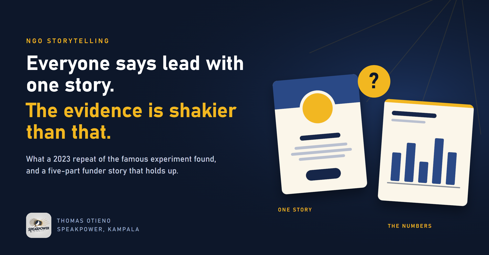
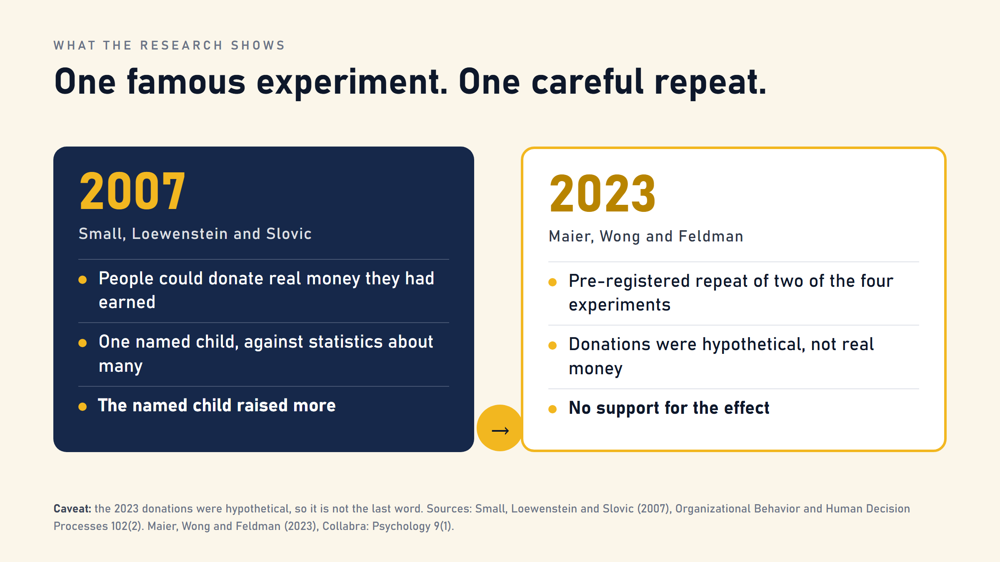
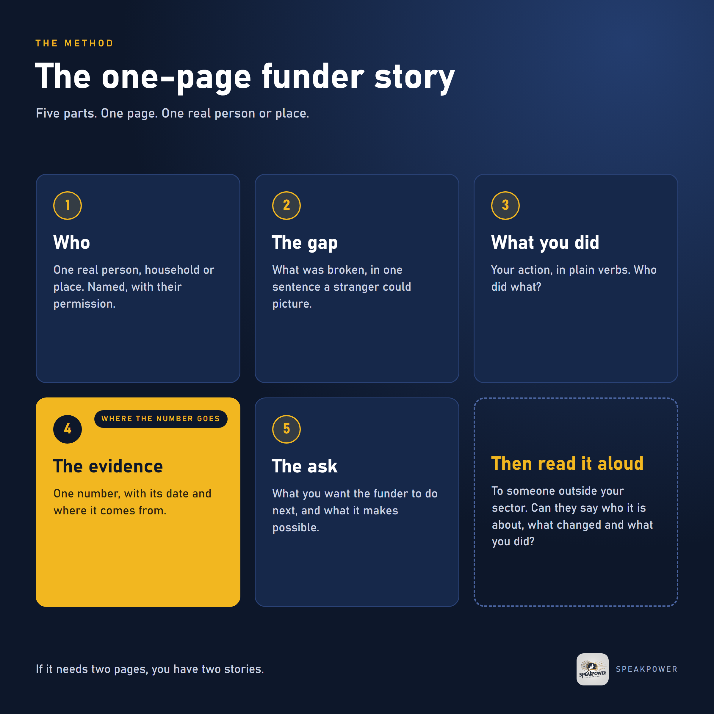
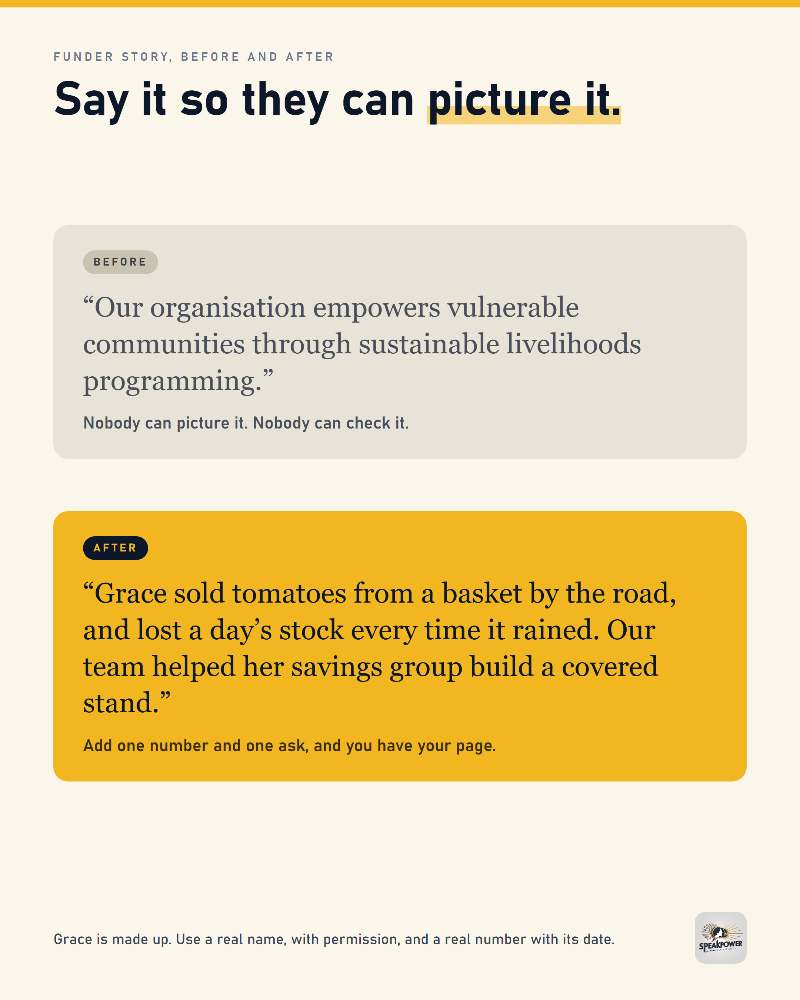

<!--
PUBLISH BLOCK (blog). Remove this comment before pasting the body.
SEO title:        NGO Storytelling for Funders: Does One Story Win?
Meta description: Does one story beat statistics with funders? A 2023 replication says the evidence is shakier than trainers claim. Here is a five-part funder story.
URL slug:         ngo-storytelling-funders
Target keyword:   NGO storytelling
Secondary:        funder story, nonprofit storytelling, grant proposal writing, identifiable victim effect
Service line:     4. Narrative Architecture for Startups & Nonprofits
Pillar:           Public Speaking / Storytelling
Written for:      TARGET audience (NGO leaders and the people who write their proposals)
-->

# Everyone Says Lead With One Story. The Evidence Is Shakier Than That.

*Alt text: Two cards side by side, one showing a person's profile and the other a bar chart, with a gold question mark between them.*

Here's the advice every NGO gets.

Lead with one person. A name, a face, a story. Statistics put funders to sleep.

I've nodded along to it for years. My own storytelling arc starts with a hero.

So when I went looking for the research behind it, I expected a clean answer.

I didn't get one.

## Where the advice comes from

The famous experiment is from 2007. Small, Loewenstein and Slovic let people donate real money they had earned. Some read about one named child in need. Others read statistics about many children.

The named child raised more.

Then came the finding trainers love most. When the statistics were placed next to the one child, people gave less than they did for the child alone.

And that's how "never put numbers next to your story" was born.

## Then somebody checked

In 2023, Maximilian Maier, Yik Chun Wong and Gilad Feldman repeated two of the four original experiments. Their study was pre-registered, which means they fixed their method before seeing any results. It appeared in Collabra: Psychology.

They found no support for the effect.

People didn't give more to the one child. They seemed insensitive to how many people were affected, whether it was one or many.

*Alt text: Two cards. 2007, Small, Loewenstein and Slovic: real money, one named child against statistics, the named child raised more. 2023, Maier, Wong and Feldman: pre-registered repeat of two experiments with hypothetical donations, no support for the effect.*

There's a fair caveat. Their donations were hypothetical, not real money, and the authors say so themselves. So this isn't the last word.

But it's enough to make me stop repeating the old advice as if it were settled.

Notice the phrase they reach for: insensitive to numbers. If that's true, ten children and ten thousand children can feel much the same to a reader. Which means your "reached 10,000 beneficiaries" line may not be working as hard as you think.

## So what do I tell NGOs now?

Not "drop the story." Stories do other jobs. They make a proposal readable, and they show you have actually been in the room.

But a funder isn't deciding whether to feel something. They're deciding whether to trust you with money.

So build the story on things they can picture and check, not on a trick.

Here's what I'd keep: one specific person or place. And here's what I'd drop: the rule that numbers must never share a page with your story.

I should be straight about the limits, too. These were donation experiments, not funders reading proposals. I haven't found a study that tests that, and I'd treat anyone who claims to know exactly what moves a programme officer with suspicion.

## Three fixes I'd make first

Before any storytelling, look for these.

**Adjectives doing a noun's job.** "Vulnerable", "sustainable", "empowering". A funder can't picture any of them. Swap each for something they could see.

**History before the point.** Three paragraphs on when you were founded, and the story starts on page two. Start with the person.

**A number with no date or source.** It reads like decoration. Add the year and where it came from, and it becomes evidence.

## The one-page funder story

Here's the five-part version I use.

**1. Who.** One real person, household or place. Named, with their permission.

**2. The gap.** What was broken, in one sentence a stranger could picture.

**3. What you did.** Your action, in plain verbs. Who did what?

**4. The evidence.** One number, with its date and where it comes from.

**5. The ask.** What you want the funder to do next, and what it makes possible.

*Alt text: Five numbered cards: who, the gap, what you did, the evidence, the ask. The evidence card is highlighted, with a sixth tile suggesting you read the page aloud to a stranger.*

It all fits on one page. If it needs two, you have two stories.

Notice where the number sits. Not instead of the person, and not fighting her for attention. Right after the action, doing its job: showing the story isn't a one-off.

And a word on consent. If someone can't say no, don't tell their story. Change the details, or tell the story of a place instead.

## Before and after

Here's a line you've probably read in a proposal. I made it up, so I embarrass nobody.

"Our organisation empowers vulnerable communities through sustainable livelihoods programming."

Nobody can picture that. Nobody can check it either.

Now the same organisation, with the five parts.

"Grace sold tomatoes from a basket by the road, and lost a day's stock every time it rained. Our team helped her savings group build a covered stand."

(Grace is made up too. Yours needs her real name, her permission and your real number, with its date.)

Short. Specific. Add one number and one ask, and a funder knows exactly what to say to you next.

*Alt text: A grey card with a vague sentence about empowering vulnerable communities, and a gold card with a specific sentence about a woman, her tomato basket and a covered stand. A note says the example is made up.*

## Test it in ten minutes

Read your opening paragraph aloud to someone outside your sector. Don't show them the page.

Then ask three questions. Who is it about? What changed? What did your organisation actually do?

If they can't answer all three, a funder can't either.

Fix one sentence at a time. Then read it aloud again, to a second person this time, before anything gets sent.

## Your Monday task

Open your last proposal. Find the first sentence that names a real person or place.

Now count the words before it.

That number is your baseline. Write it on a sticky note and put it where you'll see it. Do the same for two older proposals and compare. If you can't find a person or place at all, you've found your fix.

Then move that sentence up to the top, and count again.

## Why I'm telling you this

Because it would have been easier to repeat the tidy advice. It sounds confident. Everyone nods.

But I run a data-driven communications practice. If I pass on a finding that a careful repeat couldn't reproduce, I'm not doing the data-driven part.

If you'd like a second pair of eyes on your own funder story, message me. I'll tell you which of the five parts is missing.

If a funder read only your first paragraph, what would they know?

*Thomas Otieno | Strategy & Market Development Expert | Data-Driven Communications Architecture | Brand Storytelling. SpeakPower, Kampala.*
